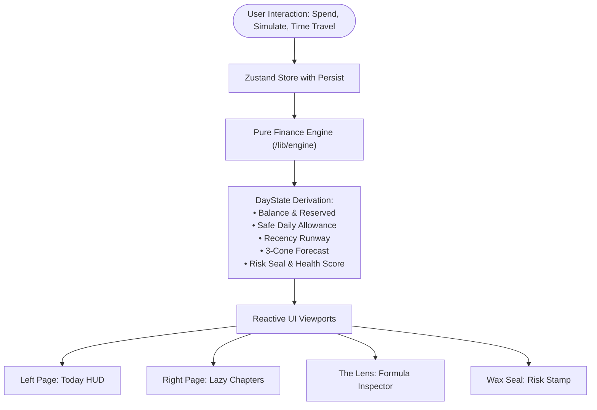

# 🏛️ INKWELL System Architecture

This document describes the architectural design, component interactions, and state propagation principles of **INKWELL — The Personal Finance Sketchbook for Gen Z**.

---

## 1. High-Level System Overview

INKWELL is architected around a **pure, unidirectional deterministic financial core** isolated from the React rendering layer. Every mutation flows strictly from user intent through the calculation engine before updating state.



---

## 2. Component Layering

```
┌─────────────────────────────────────────────────────────────┐
│ 1. Application Shell & Routing (/app)                       │
│    • layout.tsx: Global fonts, metadata, tokens             │
│    • page.tsx: Skip navigation, TheLens, Navbar, Ledger     │
│    • error.tsx, loading.tsx, not-found.tsx: Error boundaries │
│    • /api/seed & /api/events: Mock API endpoints            │
├─────────────────────────────────────────────────────────────┤
│ 2. Sketchbook UI System (/components)                       │
│    • TheLedgerBook.tsx: 3D dual-page flip layout            │
│    • TheLens.tsx: rAF-optimized brass cursor inspector      │
│    • WaxSealStamp.tsx: 3D SVG physical risk seal            │
│    • MarginNote.tsx: Reactive handwritten coaching notes    │
│    • QuickAddExpenseModal.tsx, SettingsModal.tsx: Dialogs   │
├─────────────────────────────────────────────────────────────┤
│ 3. Chapter Pages (/components/pages) [Code-Split]           │
│    • 01: OverviewPage (Eager)                               │
│    • 02: SpendingPage (Dynamic next/dynamic)                │
│    • 03: CommitmentsPage (Dynamic next/dynamic)             │
│    • 04: GoalsPage (Dynamic next/dynamic)                   │
│    • 05: SimulatorPage (Dynamic next/dynamic)               │
│    • 06: ForecastRiskPage (Dynamic next/dynamic with Recharts│
│    • 07: HealthInsightsPage (Dynamic next/dynamic)          │
│    • 08: MonthEndReportCard (Dynamic next/dynamic)          │
├─────────────────────────────────────────────────────────────┤
│ 4. State Management (/lib/store)                            │
│    • useFinanceStore.ts: Zustand with persist migration     │
├─────────────────────────────────────────────────────────────┤
│ 5. Pure Deterministic Core (/lib/engine) [Zero Framework]   │
│    • finance.ts: Pure math calculation functions            │
│    • types.ts: Strict TypeScript domain models              │
│    • schemas.ts: Zod runtime validation schemas             │
├─────────────────────────────────────────────────────────────┤
│ 6. Centralized Configuration (/lib/config)                  │
│    • constants.ts: Thresholds, weights, defaults            │
└─────────────────────────────────────────────────────────────┘
```

---

## 3. Decision Ripple Propagation Mechanics

When a user proposes a scenario in the **Decision Simulator**:

1. **Virtual Forking**: The engine creates an in-memory clone of `EngineInput` and applies the candidate decision stack.
2. **Zero-Side-Effect Evaluation**: `simulateScenario()` executes the full suite of formulas against both the `before` state and `after` candidate state.
3. **Delta Derivation**:
   - $\Delta \text{Balance}$: Immediate net impact on disposable cash.
   - $\Delta \text{Safe Daily Allowance}$: The daily disposable impact across the remaining cycle days.
   - $\Delta \text{Runway}$: Change in days until zero cash.
   - $\Delta \text{Risk Score}$ & $\Delta \text{Health Score}$: Shifts in vulnerability indices.
4. **Editorial Verdict Synthesis**:
   - The engine generates plain-language trade-off warnings (e.g. *"This purchase reduces your safe allowance below ₹150/day and delays your Goa Trip by 4 days"*).
   - Generates 3 smart alternatives:
     - **Option 1**: Defer purchase until after fixed bills clear.
     - **Option 2**: Split cost 50% via UPI / student discount.
     - **Option 3**: Divert capital from lowest-priority savings goal.
5. **Commitment & Instant Rollback**:
   - Clicking "Commit" executes state mutation and captures a reverse closure enabling 1-click rollback via toast notification.

---

## 4. Performance & Code Splitting Design

- **Dynamic Module Bundling**: Recharts (4.4 MB) is isolated exclusively within the `ForecastRiskPage` chunk and only fetched when the user turns to Chapter 06.
- **Initial First Load JS**: Maintained at **152 kB**, with the base page size at **64 kB**.
- **Frame-Rate Stability**: All mouse-tracking operations in `TheLens` use `requestAnimationFrame` with cancel tokens, maintaining 60fps even under heavy DOM load.

---

## 5. Security & Privacy Guarantees

- **100% Client-Side Privacy**: Zero telemetry, zero external trackers, zero paid database requirements. All records reside exclusively within device `localStorage`.
- **HTTP Security Headers**: Enforced via `next.config.js`:
  - `Strict-Transport-Security: max-age=63072000; includeSubDomains; preload`
  - `X-Content-Type-Options: nosniff`
  - `X-Frame-Options: SAMEORIGIN`
  - `Referrer-Policy: origin-when-cross-origin`
  - `Permissions-Policy: camera=(), microphone=(), geolocation=()`
